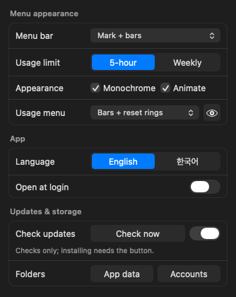
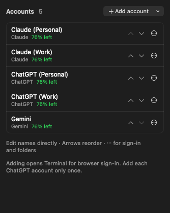

# AI Illuminati

**A macOS menu bar app for monitoring Claude, ChatGPT/Codex, and Gemini subscription accounts and working with multiple AIs.**

Free and open source · **MIT License** · macOS 13 or later · English / Korean

> The app is free. AI features require each provider's CLI and an eligible account. Subscription fees, usage limits, and service terms are set by each provider. This is not an official product of Anthropic, OpenAI, or Google.

## Features

- **Per-account usage:** five-hour and weekly remaining limits, reset times, multiple accounts, and compact bar, ring, or card layouts.
- **Animated menu bar:** per-account meters, color or monochrome, eye movements, blinking, and a pulsing golden halo. Respects Reduce Motion.
- **AI conversations:** a plain chat with one AI that the app picks by remaining usage and hands to another account when it runs low, plus discussion, critical debate, collaboration, and independent voting.
- **Several chats at once:** while one chat answers, open another or start a new one; up to 3 chats answer at the same time (a spinner marks them in the list).
- **Opening the chat:** from the menu, from Spotlight (⌘Space, "AI Illuminati"), or from the Dock: while the chat window is open the app shows in the Dock, where it can be kept (Options → Keep in Dock); clicking it opens the chat.
- **File collaboration:** linked folders, read/write/execute permissions, task assignment and review, backups, and undo.
- **Images:** attach pictures and display or share AI-generated images. Capabilities vary by provider.
- **Poker:** play Texas Hold'em with AIs, or watch AIs play, using virtual chips. No real-money transactions.
- **Updates:** optional automatic checks; installation requires a user action.

## Screenshots

These are **actual app views rendered with fictional accounts**. They contain no real user screen captures, accounts, or conversations.

<p>
  
  
</p>

## Download and installation

Download **[AI-Illuminati-0.2.0-source.zip](https://github.com/jason401/ai-illuminati/releases/download/v0.2.0/AI-Illuminati-0.2.0-source.zip)**. **The ZIP is the only download needed for installation.**

`SHA256SUMS` is an optional text file for checking download integrity. The installer does not require it. See [GitHub Releases](https://github.com/jason401/ai-illuminati/releases) for all assets.

**This is a source installation package**, not a ready-to-run `.app` or DMG. The current installation and update system preserves a local signing identity on each Mac. No maintainer signing keys or account credentials are distributed.

1. Prepare Xcode Command Line Tools and Python 3 on macOS 13 or later. Run `xcode-select --install` to open Apple's installation prompt.
2. Extract the ZIP. If you want to verify its integrity first, see the optional checksum section in the [installation guide](docs/INSTALL.md).
3. Run **`Install AI Illuminati.command`**. It downloads the official repository's **`v0.2.0` tag** into a new folder, prepares local signing, and builds on your Mac. Initial compilation takes time.
4. If AI Illuminati is already running, finish active work and quit it first. The candidate migrates to `/Applications/AI Illuminati.app`.
5. Add accounts in Settings → Accounts using each AI tool's official browser sign-in. Do not enter passwords or API keys into this app.

A paid Apple Developer account is not required. However, the app has **no Apple Developer ID signature or notarization**, so macOS may block it. After confirming that the download is from the official source and deciding you trust it, use System Settings → Privacy & Security → **Open Anyway**. This does not guarantee safety. Do not disable Gatekeeper or SIP or remove quarantine attributes in bulk. See [Apple's guidance](https://support.apple.com/en-us/102445).

### Install directly from Git

```bash
git clone --branch stable --single-branch https://github.com/jason401/ai-illuminati.git
cd ai-illuminati
zsh tools/setup_signing.sh
zsh tools/build_app.sh
```

Signing setup creates a local code-signing certificate and private key on your Mac. Approve any macOS prompts yourself. Do not share the private key or upload it to GitHub. To build without opening the candidate, use `zsh tools/build_app.sh --stage`.

Claude Code, Codex, and Antigravity CLI (agy) are **separately installed and licensed tools**, not included in this package. Codex is located in supported standard executable paths or a supported app bundle. See [usage and prerequisites](docs/USAGE.md).

## Privacy and permissions

- The app reads local authentication information to check usage. AI requests go through the corresponding provider's CLI or service. **This is not an offline-only app.** Linked materials may be sent to AI providers.
- Account lists, conversations, image copies, backups, and update source are stored under `~/Library/Application Support/AI Illuminati`. App-specific CLI accounts are under `~/.ai-illuminati`. Some credentials are stored in macOS Keychain. Provider CLIs may keep their own session records.
- API keys are not required. Follow each provider's sign-in process, service terms, and organizational policies.
- Collaboration in **Write / Write + Execute** mode can change real files. Review permissions and changes, and keep independent backups of important files.
- Do not include emails, credentials, real conversations, or personal paths in public screenshots, logs, or issue reports.

See [SECURITY.md](SECURITY.md) for reporting guidance and sensitive-file handling.

## Updates and development

Installed apps check the public `stable` branch. When automatic checks are enabled, checks run about 60 seconds after launch and every three hours. **Update Now** starts tests, a local build, and installation. Command Line Tools, Python, and the existing local signing identity remain required. The app does not automatically modify developer checkouts.

Detailed instructions: [docs/USAGE.md](docs/USAGE.md).

```bash
zsh tools/tests/run_mode2.sh
python3 tools/tests/check_signing.py "/Applications/AI Illuminati.app"
```

Some tests need access to the macOS pasteboard. The default regression suite does not call live AI models.

## AI-assisted development

The maintainer sets the direction and requirements. **Claude Code, OpenAI Codex, and other AI development tools assisted with implementation, review, and testing.** AI-generated work can contain mistakes. Users should review account access, materials, file permissions, and actual changes.

## License

**Copyright (c) 2026 jason401. [MIT License](LICENSE).** Free use, modification, redistribution, and commercial use are permitted, provided the copyright and license notices are retained. The software is provided without warranty.

External AI services, separately installed CLIs, Apple system components, and trademarks have their own terms. See [THIRD_PARTY_NOTICES.md](THIRD_PARTY_NOTICES.md).
